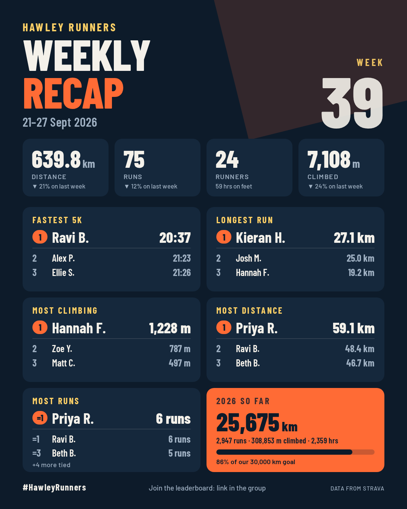

# Club Recap

Weekly Strava recap infographics for running clubs. Built for **Hawley Runners**, designed so any club can be added with one config file.

Runners opt in by connecting their Strava once. Every Monday you open the recap page, pick the week, download a 1080 × 1350 PNG and copy the ready-made caption into Facebook or the Strava club.

The recap shows:

- **This week's awards (top 3):** fastest 5K (a true best-effort split, not average pace), longest run, most climbing, most distance, most runs.
- **Group totals:** distance, runs, runners and climbing, compared with last week.
- **Year to date:** distance, runs, climbing and hours, with a progress bar towards the club's goal.
- **Milestones:** anyone who passed 100 / 250 / 500 / 1,000 km (and so on) for the year that week.

It costs nothing to run: GitHub Pages, Cloudflare's free Workers tier and the free Strava API.



---

## How it fits together

```
 Runner ── "Connect with Strava" ──▶  Cloudflare Worker  ◀── webhooks ── Strava
                                     │  OAuth + club check
 GitHub Pages (static)               │  D1 database (minimal run data)
   index.html      join / leave      │  hourly catch-up sync
   recap.html      infographic ◀─────┤  GET /api/clubs/:slug/summary
   admin.html      opt-out list ◀────┘  /admin/* (token protected)
```

| Folder | What it is |
|---|---|
| `config/clubs/` | One JSON file per club: Strava club ID, rules, awards, goal, branding. **This is the white-label layer.** |
| `packages/core/` | The stats engine: eligibility rules, weekly awards, totals, YTD, milestones. Pure TypeScript, unit tested. |
| `apps/worker/` | Cloudflare Worker: Strava OAuth, membership check, webhooks, hourly sync, public summary API, admin API. |
| `apps/web/` | The static site for GitHub Pages. No build step. |
| `scripts/` | Sample data generator, mock Strava server, webhook and secret helpers. |

### Rules that make it fair

- **Opt-in only:** nobody appears unless they connected via the club's link.
- **Club members only:** membership of the club's Strava group is checked on connect and re-checked weekly. Leavers drop off automatically.
- **Admin hide list:** hide anyone from the recap (`admin.html`). It is keyed by club and Strava ID, so it survives the runner disconnecting and reconnecting.
- **What counts:** `rules.sportTypes` (Hawley: `Run`, `TrailRun`, `VirtualRun`, matched on Strava's `sport_type`). An award can narrow that with its own `sportTypes`: Fastest 5K and Longest run leave out `VirtualRun`. Manual entries, flagged activities, runs under 1 km and anything faster than 2:30/km (usually a bike ride saved as a run) are ignored.
- **Fastest 5K** uses Strava's best-effort split from GPS runs, so a quick 5K inside a 10K counts.
- **Ties** share a place (`=1`). If more people tie than fit on the podium, the card says "+N more tied".
- **Weeks** run Monday to Sunday on the runner's local date.

### Privacy by design

- Stored per run: sport type, local start time, distance, moving time, climbing, the manual/treadmill/flagged flags the rules need, and the best 5K. No titles, maps, locations, heart rate or photos.
- Stored per runner: Strava ID, first name, surname *initial*, encrypted tokens.
- Only the hide list (club + Strava ID) outlives a disconnect.
- Strava tokens are AES-GCM encrypted at rest.
- Only "First L." ever leaves the Worker publicly.
- If a runner revokes access in Strava (Strava's deauthorisation webhook), uses "Remove my data" on the join page (we revoke their token with `POST /oauth/revoke`), or leaves the club's Strava group (checked weekly), everything about them is deleted. Only a successful "not in this club" answer from Strava counts as leaving: an error or rate limit never does.

---

## Try it locally (no Strava needed)

Requires Node 22.13 or newer.

```bash
npm install
npm test                 # stats engine and Worker tests
npm run sample           # writes apps/web/sample/hawley-runners.json from fake runners
npm run dev:web          # http://localhost:5173/recap.html
```

With `apiBase` empty in `apps/web/assets/js/config.js`, the site runs on the sample file. That's the quickest way to tweak the design (`apps/web/assets/css/card.css`).

### Full stack locally, with a fake Strava

```bash
cp apps/worker/.dev.vars.example apps/worker/.dev.vars
# uncomment the two STRAVA_*_BASE lines in .dev.vars to point at the fake Strava
npm run db:migrate:local
npm run mock:strava      # terminal 1: fake Strava on :8788
npm run dev:worker       # terminal 2: Worker on :8787
npm run dev:web          # terminal 3: site on :5173 (set apiBase to http://localhost:8787)
```

Each visit to `http://localhost:8787/auth/start?club=hawley-runners` signs in as the next fake runner. Every 10th one isn't a club member, to test the rejection path.

---

## Quick recap (MVP, no Strava sign-ups)

Before any runners have connected, the quick recap makes the cards from the club leaderboard every member can already see on Strava. It's a paste page plus a small Python script, with no AI or accounts involved.

### One-off setup (Windows)

1. Install Python 3.10+ from [python.org](https://www.python.org/downloads/) (tick "Add python.exe to PATH").
2. In a terminal in this folder, run these two commands **one at a time** (press Enter after each):
   ```bash
   py -m pip install -r scripts/requirements.txt
   py -m playwright install chromium
   ```
   (If `py` isn't found, use `python` instead.)

### Every week

1. Double-click **`Weekly recap.bat`** (next to this folder). It opens the paste page in your browser. Leave the black window open.
2. On the club's Strava page, select the leaderboard **including its heading** ("Last Week's Leaderboard" on Monday, or "This Week's Leaderboard" late on Sunday) and copy it. The heading tells the page which week it is.
3. Paste. Check the preview, the week and the hide list, then click **Save and build PNGs**.
4. Open `recaps/<week>/`: two PNGs, `caption.txt` and `caption.md`, ready to post.

Saving the same week again (for example Sunday afternoon, then Monday with late runs) overwrites it.

### The archive

```
recaps/                      (next to this repo, so runners' names never end up on GitHub)
    settings.json            hide list, groups (e.g. women), min km for pace/hill awards, places per award
    2026-09-21/
        leaderboard.csv      everyone on the board, exactly as Strava showed it
        hawley-runners-recap-2026-09-21.png
        hawley-runners-more-2026-09-21.png
        caption.txt
        caption.md
```

The CSV columns are `week_start, rank, name, distance_km, runs, longest_km, avg_pace_per_km, elevation_m`. Hidden runners stay in the CSV and are only left off the cards, so un-hiding someone and rebuilding just works.

### Women's leaders (and other groups)

Strava's leaderboard doesn't say who is who, so nothing is guessed. Under **Settings** on the paste page there's a **Women list** with a tick box for everyone on this week's board: tick the runners to include. The list is kept in `recaps/settings.json` (never on GitHub) and carries over, so each week it's only new faces. Anyone on the list who didn't run that week shows at the bottom, still ticked.

It's still two images. The first card shows **Men's leaders** and **Women's leaders** side by side: most distance, longest run and most climbing, top 7 each, drawn from the same leaderboard. There is no men's list: everyone not ticked counts as a man, so tick new women each week. "Most time on feet" moves to the second card, whose awards follow the places setting (top 5 by default). The caption gets matching "Men's leaders" and "Women's leaders" blocks. With nobody ticked, or nobody on the list running that week, the first card falls back to the six overall awards.

Other groups can be added to `settings.json`. The first one with runners that week gets the panel:

```json
"groups": [
    { "id": "women", "label": "Women", "title": "Women's leaders", "members": ["Full Name", "…"] }
]
```

### Script commands

```bash
python scripts/recap.py serve                 # what the .bat runs
python scripts/recap.py build                 # rebuild the latest week
python scripts/recap.py build --week 2026-09-21
python scripts/recap.py build --all           # e.g. after changing the design or the hide list
python scripts/recap.py add file.csv ...      # file CSVs downloaded from the page into week folders, then build
python scripts/recap.py --archive D:/elsewhere build   # use a different archive folder
```

When building, the script checks the data and warns about duplicates, 0 km entries, impossible paces (a ride saved as a run) and a longest run bigger than the total.

The paste page also works without the script (for example on GitHub Pages): **Save CSV** downloads the file instead, the PNGs can be downloaded from the browser, and `recap.py add` files the CSV later.

The cards are drawn by `apps/web/render.html` using the same code as the page preview, so what you see before saving is what gets built.

What changes from the full version, because the leaderboard only has weekly totals per runner:

| Full version | Quick recap |
|---|---|
| Fastest 5K (true best-effort split) | Quickest average pace, with a minimum weekly distance (10 km by default) |
| Year-to-date panel and milestones | Not shown; the sixth tile is **Most time on feet** (distance × average pace) |
| Week-on-week change | From the archive, once the week before has been saved |
| Opt-in via Strava | Everyone on the club leaderboard, minus the hide list |

Awards show a top 5 by default (a compact layout; switch to top 3 on the page).

The second card, **More from the week**, adds what else the leaderboard supports:

- **Longest average run** (distance ÷ runs, 2+ runs)
- **Hill seeker** (metres climbed per km, same minimum distance as the pace award)
- **Quickest pace (5–10 km)**, so runners below the main pace award's minimum get a chance
- **Biggest step up** in distance on the week before (only when the week before is known)
- **Club distance**: a line chart of the club's total km for this week and up to four weeks before (only weeks saved in the archive are plotted; it's left out until one earlier week exists)
- **Everyone who ran**: a roll call, with anyone not on the week before's board highlighted

Names are still shown as "First L.". The parser lives in `apps/web/assets/js/leaderboard.js` and handles km or miles, the doubled names Strava copies from avatars, emoji and `--` for no climbing.

---

## Going live

Follow [SETUP.md](SETUP.md): a step-by-step checklist from creating the Strava app to the first end-to-end test. Notes for Strava's review of the app are in [docs/strava-review-notes.md](docs/strava-review-notes.md).

### Weekly routine

On Monday, open `recap.html`. It defaults to the last completed week.

1. Click **Download PNG**.
2. **Copy caption**.
3. Post it.

Late uploads are included automatically if you regenerate later.

---

## White-labelling another club

1. Copy `config/clubs/hawley-runners.json` to `config/clubs/<new-slug>.json` and change:
   - `slug`, `name` and `stravaClubId`
   - `branding` colours, `logo`, `hashtag` and `footer`
   - `awards` (any of `best5k`, `longestRun`, `distanceTotal`, `elevationTotal`, `runCount`, `movingTimeTotal`; each can set `sportTypes` to count only some run types)
   - `ytdGoalKm` and `rules`
2. Register it in `config/clubs/index.ts`.
3. Deploy the Worker. Their join link is `…/?club=<new-slug>` and their recap is `…/recap.html?club=<new-slug>`.

Consent is per club: a runner in two clubs connects once for each and can be hidden separately in each. One Strava app serves every club, so when you ask Strava for more athlete capacity, count all clubs.

Ideas for later:

- Square and 9:16 story formats
- Club records
- "Most improved"
- A per-club admin token
- A custom domain per club

---

## Free-tier budget (roughly, for 200 connected runners)

| | Usage | Free limit |
|---|---|---|
| Worker requests | a few hundred a day | 100,000 a day |
| Strava API reads | ~150–300 a day | 1,000 a day (100 per 15 min) |
| Outbound calls per Worker run | capped at 45 in code | 50 |
| D1 storage | a few MB a year | 5 GB |

The Worker reads Strava's `X-RateLimit-Limit` / `X-RateLimit-Usage` headers. The hourly sync stops its batch at 80% of either window and pauses until that window resets; a 429 pauses it for 15 minutes. Both resume by themselves.
